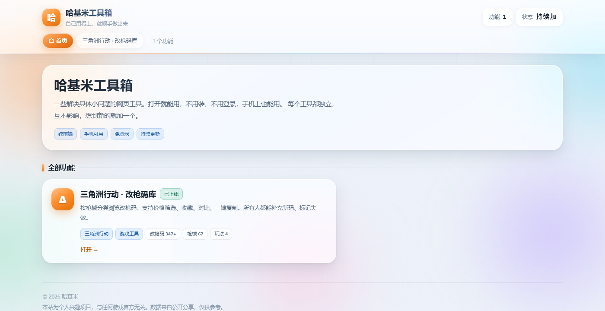
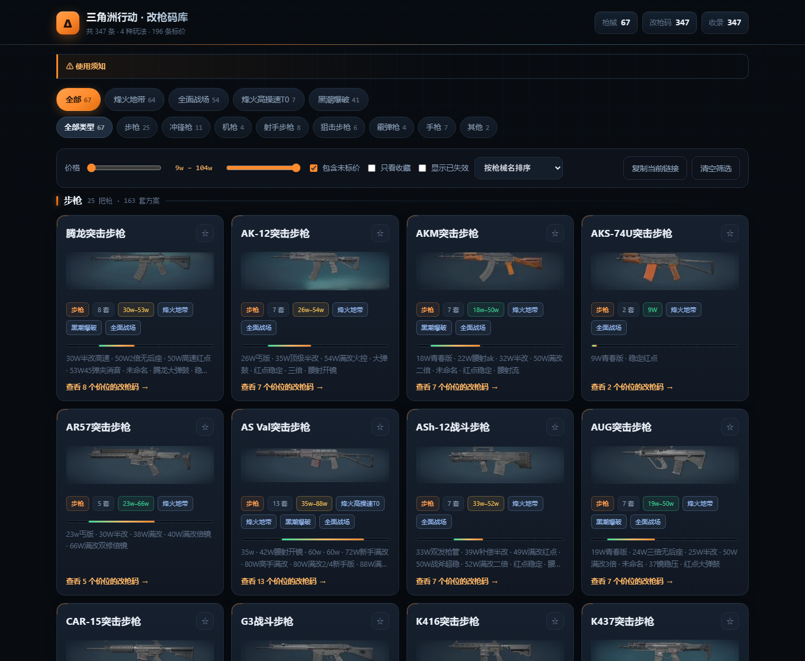
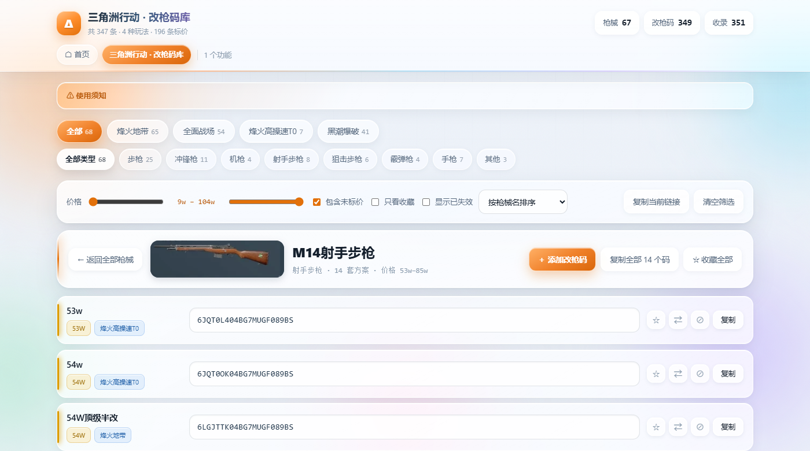
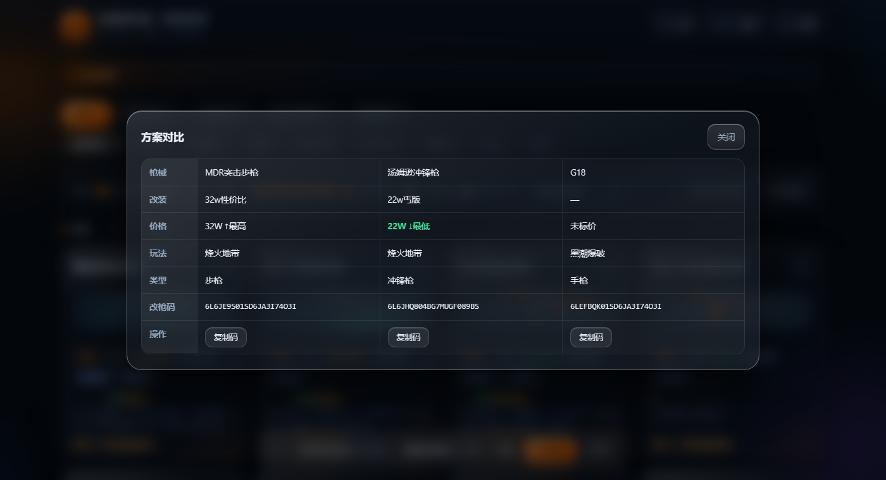
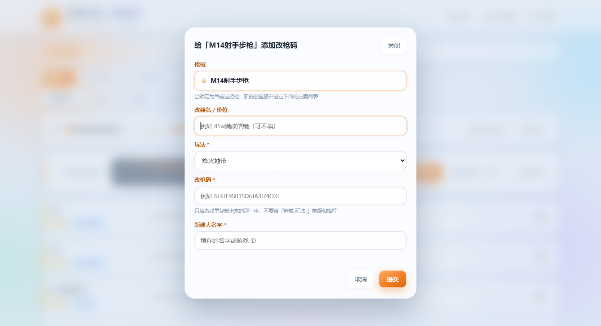
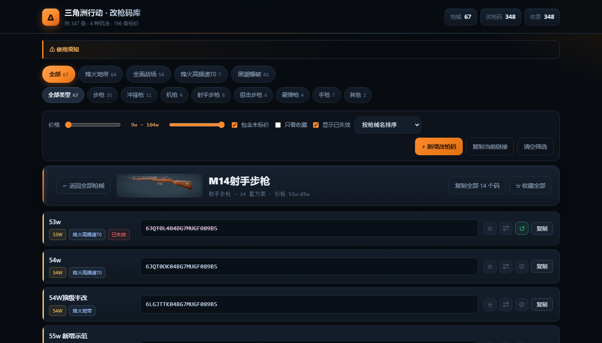

# 哈基米工具箱 · 三角洲行动改枪码库

> **🌐 站点首页：<https://hajimiovo.top/>**
> **🔫 改枪码工具：<https://hajimiovo.top/delta-codes/>**
>
> 手机、电脑直接打开，无需登录，所有人都能新增 / 标记失效改枪码。
> 镜像：<https://hajimi619.github.io/delta-codes/delta-codes/> · 仓库：<https://github.com/hajimi619/delta-codes>
> 接口：<https://api.hajimiovo.top/api/changes>

本站是一个**多功能的个人工具箱**，「三角洲改枪码库」只是其中第一个功能。
骨架已经搭好：**加新功能 = 建一个文件夹 + 在 `docs/assets/site.js` 的数组里加一行**，
首页卡片和每个页面顶部的切换导航都会自动生成。

把一份公开的腾讯文档《三角洲行动改枪码合集》里的改枪码
抓下来，做成一个能搜索、筛选、收藏、对比、一键复制的网页。

**收录 347 个改枪码 / 67 把枪 / 4 种玩法**（烽火地带 202 · 全面战场 86 · 烽火高操速T0 18 · 黑潮爆破 41）


## 功能

**没有搜索框，全部靠分类浏览。** 结构是两级：

1. **首屏按枪械类型分块**（步枪 / 冲锋枪 / 机枪 / 射手步枪 / 狙击步枪 / 霰弹枪 / 手枪 / 其他），每块下面是这类的枪械卡片
2. **点任意一张枪械卡片**，进去看这把枪的每一个价位方案

| 功能 | 说明 |
|---|---|
| 玩法分类 | 顶部标签：全部 / 烽火地带 / 全面战场 / 烽火高操速T0 / 黑潮爆破（数字是**枪械把数**） |
| 类型分类 | 第二排标签：**步枪（突击 + 战斗合并）25** / 冲锋枪 11 / 机枪 4 / 射手步枪 8 / **狙击步枪 6** / 霰弹枪 4 / 手枪 7 / 其他 2；不选时按类型**分块显示**，选了就只看这一类 |
| 枪械卡片 | 一张卡一把枪：**枪械图** + 类型 / 套数 / 价格区间 / 玩法 / 方案名预览，右上角 ★ 整把收藏 |
| 方案详情 | 点卡片进入，按价格从低到高列出每个价位：改装名 + 价格 + 玩法 + 改枪码 + 复制/收藏/对比 |
| 价格筛选 | 双滑块按价格过滤（价格从"32w性价比"这类改装名里解析），可勾选是否包含未标价 |
| 排序 | 按枪械名 / 最低价从低到高 / 最高价从高到低 / 方案数量 |
| 收藏 | 枪械卡片上 ★ 整把收藏，详情里每套可单独收藏；存在浏览器本地，顶部会出现「★ 收藏」页签 |
| 对比 | 详情页每套 ⇄，最多同时选 3 套，底部对比栏 → 并排表格（自动标出价格最高/最低） |
| 复制全部 | 详情页「复制全部 N 个码」，多行文本一行一个码，整批粘进游戏；**数量跟随当前筛选** |
| 分享链接 | 「复制当前链接」把玩法、类型、价格、排序、**正在看的那把枪**都编进 URL，打开就是同一视图 |
| 返回/前进 | 进入和退出枪械详情走浏览器历史，手机返回手势和浏览器后退键都能用 |






## 本地打开

直接双击 `docs/index.html`，纯静态、不需要服务器、不联网。

## 目录

```
delta-codes/
├─ docs/                     ← 发布目录（Cloudflare Pages + GitHub Pages 共用）
│  ├─ index.html             站点首页：功能导航（卡片由 site.js 生成）
│  ├─ assets/
│  │  ├─ theme.css           共用主题：浅色液态玻璃 + 顶栏 + 按钮 + 弹窗 + 表单
│  │  └─ site.js             功能注册表 FEATURES + 导航/首页卡片渲染
│  ├─ delta-codes/           ← 功能①：三角洲改枪码库
│  │  ├─ index.html          工具页（只写自己专属的样式）
│  │  ├─ data.js             由 build_site.py 生成（window.DELTA_DATA）
│  │  └─ img/guns/*.webp     68 张枪械图
│  └─ .nojekyll
│  └─ (以后的新功能)/         每个功能一个文件夹，互相独立
├─ data/
│  ├─ codes.json             抓取结果（基础数据，含来源 tab / 行列号）
│  └─ gun-images.json        枪名 → 图片文件名 的映射
├─ assets/
│  └─ gun-screenshots/       游戏图鉴截图（枪械图的来源，13 张）
├─ worker/                   ← 在线编辑后端（Cloudflare Worker + D1）
│  ├─ worker.js              接口代码
│  ├─ schema.sql             数据库结构
│  └─ README.md              部署指南（点点点 + 粘贴，约 5 分钟）
├─ config.json               配置：apiBase 填 Worker 地址；留空 = 只读模式
├─ scripts/
│  ├─ fetch_codes.py         从腾讯文档抓取并解析 → data/codes.json
│  ├─ extract_gun_images.py  从图鉴截图裁出每把枪 → docs/delta-codes/img/guns/*.webp
│  ├─ build_site.py          data/*.json → docs/delta-codes/data.js
│  ├─ build_singlefile.py    打包成单文件 dist/delta-codes.html（图片内联）
│  ├─ deploy_github.py       纯 REST API 部署到 GitHub Pages（不需要 git）
│  └─ deploy_pages.ps1       部署 docs/ 到 Cloudflare Pages（走 wrangler）
├─ preview/                  截图
└─ .github/workflows/
   └─ refresh-codes.yml      在 GitHub 上手动触发一次数据刷新（可选定时）
```

## 怎么加一个新功能

1. 建目录 `docs/<功能id>/`，放一个 `index.html`
2. 头部引共用主题（注意层级）：
   ```html
   <html lang="zh-CN" data-base="../">     <!-- 让 site.js 能拼对链接 -->
   <head>
     <link rel="stylesheet" href="../assets/theme.css" />
   </head>
   <body>
     <header class="top">
       <div class="top-in"> …品牌 + 统计… </div>
       <nav class="fnav" id="siteNav"></nav>   <!-- 自动生成功能切换 -->
     </header>
     …
     <script src="../assets/site.js"></script>
   </body>
   ```
3. 在 `docs/assets/site.js` 的 `FEATURES` 数组里加一条：
   ```js
   { id:"<功能id>", name:"功能名", desc:"一句话说明",
     tags:["标签"], status:"online", icon:"★" }
   ```
4. 部署。首页卡片和所有页面的顶部导航会自动出现。

共用样式已经包括：设计变量、七彩背景、顶栏、`.btn`、`.badge`、`.card`、
`.modal`、`.toast`、`.totop`、`.form-grid`、`.empty`、`.hero`、`.fcard`。

## 枪械图是怎么来的

原始素材是 13 张游戏内**枪械图鉴列表**截图（放在 `assets/gun-screenshots/`）。
`scripts/extract_gun_images.py` 会自动把每把枪裁成独立小图：

1. 图鉴每行固定高约 **89px**，行内**左上角是白色枪名文字**、下方才是枪身
2. 先用「左上角近白文字」定位每一行，行距用等差数列拟合（比按高度均分稳）
3. 再取标题下方的窗口，用**边缘强度**找枪的轮廓外接框——
   背景是平滑渐变几乎没有边缘，枪有清晰轮廓，所以这个判据比"和背景色做差"可靠得多
4. 图鉴里被**选中**的那一项有一圈近白色高亮边框，会按
   「贯穿整行/整列 + 亮度 > 200」识别出来，连同两侧的抗锯齿一起剔除

输出 68 张 WebP（每把枪约 1.5 KB，**合计 105 KB**），页面用 CSS 径向遮罩把图片边缘
淡出，融进卡片背景。

重新生成：

```powershell
& $py scripts\extract_gun_images.py
& $py scripts\build_site.py
```

## 在线编辑

站点**已经开启**在线编辑，后端是 **Cloudflare Worker + D1**（免费额度足够），
接口地址 <https://api.hajimiovo.top>，写进 `config.json`：

```json
{ "apiBase": "https://api.hajimiovo.top" }
```

`apiBase` 留空即回到只读模式。部署步骤见 [worker/README.md](worker/README.md)。

页面上的入口：**先点开某把枪**，在它详情页右上角点 **「＋ 添加改枪码」**——
枪名会锁定成当前这把枪，提交后直接并进它下面的方案列表，不会另起一张卡片。
每条的失效开关在右侧的 **⊘**（已失效的点 **↺** 恢复）。

**接口：**

| 方法 | 路径 | 作用 |
|---|---|---|
| GET | `/api/changes` | 拉取全部改动（新增 + 失效标记） |
| POST | `/api/add` | 新增一个改枪码 |
| POST | `/api/flag` | 标记失效 / 恢复 |

**防滥用：** 同一个码不能重复提交 · 每 IP 每小时最多 30 次写操作 ·
枪械名 / 名字 / 备注都有长度上限 · CORS 只放行自有域名和 GitHub Pages。

**设计上刻意做了两层保护：**

1. **删除 = 标记失效**，不是真删。码还在，只是折叠 + 显示"已失效"，任何人可点 ↺ 恢复。
2. **基础 347 条不在数据库里**，而是躺在仓库的 `data/codes.json`（有 git 历史）。
   数据库只存"新增"和"失效标记"，所以**就算数据库被清空，基础数据一条不少**，
   重跑一次 `fetch_codes.py` 就恢复。

新增时会要求填 **新建人名字**，列表上会显示"由 XXX 添加"。




## 访问速度 / 国内可用性

站点跑在 **Cloudflare**（Pages + Worker），国内访问**能连上但不稳**。实测：

| 环节 | 实测 | 说明 |
|---|---|---|
| DNS 解析 | 5–20ms | 正常 |
| TCP 连接 | 200–250ms | **偏大**（就近节点应 30–60ms） |
| TLS 握手 | 0.5s ~ 21s，偶发超时 | **瓶颈在这** |
| `CF-RAY` 落地机房 | **LAX（洛杉矶）** | 中国流量被路由到美国西岸 |

根因是**线路**，不是网站：Cloudflare 免费版在中国大陆没有就近节点，
运营商 BGP 把流量丢到了洛杉矶，200ms+ 延迟叠加丢包，TLS 握手反复重传。

> **换数据库没有任何帮助。** 实测静态页面和接口的耗时几乎一样
> （tcp 0.2–0.3s / tls 0.5–3.7s / ttfb 0.9s~超时），瓶颈都在同一段网络上。
> 数据库只决定那 1.6KB JSON 的内容，请求照样得走这条路。

已经做的免费优化：

| 措施 | 效果 |
|---|---|
| `sw.js` Service Worker | **第二次起完全走本地缓存**，不依赖网络 |
| 接口改同源 `/api/*`（Worker 路由） | 省掉一次跨域 TCP + TLS 握手 |
| 开 0-RTT / Early Hints | 复访握手省一个来回 |
| HTML 里 preconnect 接口域名 | 提前建连 |
| `_headers` 缓存策略 + favicon | 图片长缓存，每次少一个 404 |
| 顶栏「接口 已连接 / 连不上」徽章 | 区分"后端连不上"和"没人提交过" |
| 接口失败自动重试一次 | 提高成功率 |

### 试过但没用的两条路（别再踩）

**① 换 Cloudflare 的 IP 段 —— 无效**

实测 44 个 Cloudflare IP 段，确实有好段（`104.26.x` / `162.159.128.x` 落**香港**，首字节 286ms，
而当前分到的 `104.21.x` / `172.67.x` 实测**直接超时**）。

于是把 zone 删掉重建，想赌一个新 IP：

```
删除前：104.21.61.140, 172.67.210.249
重建后：104.21.61.140, 172.67.210.249   ← 一模一样，连 zone_id 都复用了
```

**结论：Cloudflare 给一个域名的边缘 IP 是固定的，删了重建也白搭。**
（免费版没有官方途径更换；网上流传的「优选IP」需要 Cloudflare for SaaS，会破坏
Pages 的自定义域名，不值得折腾。）

**② 关掉代理直连 pages.dev —— 更慢**

既然 pending 状态下 CNAME 会直接透传到 `pages.dev` 的 IP，就测了一下：

| | 成功 | 中位首字节 | 最慢 |
|---|---|---|---|
| 走 Cloudflare 代理（现状） | 7/8 | **1.4 秒** | 11.9s |
| 直连 pages.dev 的 IP | 8/8 | **3.6 秒** | 24.0s |

**直连反而更慢**，而且会破坏 `hajimiovo.top/api/*` 的 Worker 路由。

**要根治只能把站点搬离 Cloudflare**：

| 方案 | 国内速度 | 成本 | 门槛 |
|---|---|---|---|
| **国内轻量服务器** ⭐ | 最快（RTT 10–30ms） | **¥192/年**（常见 4 折） | 要 ICP 备案，1–3 周 |
| 香港轻量服务器 | 30–60ms，**晚高峰不稳** | ¥456/年 | 不用备案，但腾讯云官方写明「不保障跨境质量」 |
| CN2 GIA 优化线路 VPS | 30–60ms 稳定 | ¥350–700/年 | 免备案，但要会挑商家 |

> **避坑**：腾讯云/阿里云的香港、新加坡低配轻量（¥34–40/月）线路都是普通国际 BGP，
> 官方明确标注**不保障中国内地与香港之间的跨境质量**，晚高峰可能比 Cloudflare 还差。
> 真要免备案又稳定，得上 CN2 GIA，那就 ¥350–700/年了 —— 不如备案划算。

### 迁移到国内服务器（进行中）

已经买了一台腾讯云轻量（南京，2核2G，¥192/年），并配好了整套环境：

```
119.45.171.242   （备案通过前先用 http://119.45.171.242:8080/ 访问）
├─ /var/www/hajimiovo/          站点静态文件（由 deploy_server.py 上传）
├─ /opt/hajimiovo-api/server.js 接口服务（Node，无任何 npm 依赖）
├─ /var/lib/hajimiovo/changes.json  网友改动（JSON + 原子写入，替代 D1）
├─ systemd: hajimiovo-api       守护进程，崩溃自动重启
├─ nginx                        静态托管 + 反代 /api/*，gzip，缓存策略
└─ /root/s3_golive.sh           备案通过后一键开 80/443 + 申请 HTTPS 证书
```

**实测速度对比**（同一时刻，两台机器）：

| | **南京服务器** | Cloudflare（洛杉矶） |
|---|---|---|
| TCP 连接 | **17–36ms** | 296–558ms |
| 首字节 | **33–86ms** | 4.1–14.7 秒 |
| 总耗时 | **0.04–0.09 秒** | 15.6–25 秒 |

**为什么后端不用 SQLite**：接口只需要存网友的几十条改动，用 JSON 文件 + 原子写入
（先写 `.tmp` 再 `rename`，写入串行化）完全够用，**零 npm 依赖**，部署不会因为
原生模块编译失败而卡住，备份就是复制一个文件。

**部署命令**：

```powershell
# 站点
& $py scripts\deploy_server.py
# 站点 + 后端（改了 server.js 时）
& $py scripts\deploy_server.py --api --reload-nginx
```

**备案通过后的切换步骤**：

1. 腾讯云防火墙放行 TCP **80、443**（8080 可以关掉了）
2. DNS 把 `hajimiovo.top` 指到 `119.45.171.242`
   - 快：Cloudflare 里把 A 记录改成这个 IP，**代理关掉（灰云）**，几分钟生效
   - 彻底：NS 改回腾讯云 DNSPod，1–2 小时生效
3. SSH 上去跑 `/root/s3_golive.sh` —— 自动配 80/443 + 申请 Let's Encrypt 证书 + 设置自动续期
4. 验证 `https://hajimiovo.top/`

> 切换完成后 Cloudflare 的 Pages / Workers / D1 就都可以停用了。
> 注意 `docs/sw.js` 里的 `VERSION` 要 bump 一次，否则老访客的 Service Worker
> 会继续用云端缓存的旧文件。

## 管理员系统

页面上有个「管理员」入口（顶栏右侧）。登录后：

| 能力 | 说明 |
|---|---|
| **✎ 编辑** | 改任意一条的枪名 / 改装名 / 玩法 / 码本身，**包括那 347 条基础数据** |
| **🗑 隐藏** | 从列表移除，进回收站，可恢复 |
| **✖ 永久删除** | 只对网友新增的条目可用，物理移除，不可恢复 |
| **回收站** | 列出所有「已失效 + 已隐藏」的条目，一键恢复 / 清除失效标记 |
| **清除全部失效标记** | 别人恶意标记的失效，一条命令全清 |

### 普通用户不受影响

任何人仍然可以**新增**改枪码、**标记失效**。管理员只是多出「编辑 / 隐藏 / 永久删除」的超能力，
以及能清除**别人**标的失效标记。

### 数据是怎么存的

所有管理员操作也走 `changes` 这一套（和网友提交一样落库、可追溯），新增两种类型：

| type | 含义 | 前端的处理 |
|---|---|---|
| `edit` | 覆盖某条的内容 | 渲染时把字段盖上去，行上显示「已编辑」 |
| `delete` | 隐藏某条（`status:"valid"` 表示撤销隐藏） | 从列表过滤掉，回收站里能看到 |

同一个目标只会保留**最新一条** `edit` / `delete`，不会堆积。

### 账号管理

```powershell
# 设置/重设管理员账号（交互式输密码）
& $py scripts\set_admin.py --user hajimi

# 随机生成一个 16 位强密码
& $py scripts\set_admin.py --user hajimi --generate

# 看当前配置（不显示密码）
& $py scripts\set_admin.py --show
```

- 密码用 **scrypt**（N=16384, r=8, p=1, dklen=64）哈希后存在
  `/var/lib/hajimiovo/admin.json`（权限 600），**明文不落盘**
- 登录后发一个 64 位随机令牌，存 `/var/lib/hajimiovo/tokens.json`，**30 天有效**，重启不掉线
- 单 IP 15 分钟内失败 8 次就锁 15 分钟，防爆破
- 所有 `/api/admin/*` 接口都校验 `Authorization: Bearer <token>`，
  **前端藏按钮不算数，后端才是防线**

> 想踢掉所有已登录设备：把 `tokens.json` 清空成 `{}` 再重启服务即可。

### 备案期间的管理方式（走过弯路，记下来免得再试）

**能不能让 `hajimiovo.top` 上的管理员功能也能用？** 试过了，**不行**，两条路都被堵死：

**① Cloudflare Worker 不能 fetch 裸 IP**

想让 Worker 把 `/api/*` 转发到服务器 `119.45.171.242:8080`，实测**对任何 IP 都立刻返回
`403 error code: 1003`**（Cloudflare 的「不允许直接 IP 访问」），只有它自家的 `1.1.1.1` 例外：

| 目标 | 结果 |
|---|---|
| `http://119.45.171.242:8080/…` | 403 error code: 1003（0–1ms，内网就拒了） |
| `http://8.8.8.8/` | 403 error code: 1003 |
| `http://114.114.114.114/` | 403 error code: 1003 |
| `http://1.1.1.1/` | **200**（Cloudflare 自己的） |

**② 换成域名回源 —— 被腾讯云的备案拦截挡住**

于是加了一条灰云记录 `origin.hajimiovo.top -> 119.45.171.242`，让 Worker 用域名回源。
结果拿到的是腾讯云的未备案提示页：

```
HTTP/1.1 302 Found
Location: https://dnspod.qcloud.com/static/webblock.html?d=origin.hajimiovo.top:8080
```

**关键发现：腾讯云的备案拦截是按 `Host` 头判断的，不是按端口。**
任何用「未备案域名」访问境内服务器的请求——**哪怕走 8080**——都会被重定向到那个提示页。
只有用**裸 IP** 访问才放行（所以 `http://119.45.171.242:8080` 一直是通的）。

想伪造成裸 IP 绕过也没用：Cloudflare Worker **不允许覆盖 `Host` 头**，实测仍然是那个 302。

**所以备案通过前，域名访问服务器的路是死的。**

**当前的折中：服务器每小时自动同步 D1**

```
群里人  →  https://hajimiovo.top/          →  Cloudflare D1
                       ↓  每小时拉一次，按 id 去重并入
你管理  →  http://119.45.171.242:8080/     →  服务器 JSON（是 D1 的超集）
```

同步脚本 `/usr/local/bin/hajimiovo-sync-d1`，cron 在 `/etc/cron.d/hajimiovo-sync`（每小时第 17 分钟）。
**只新增不覆盖**（本地已有的 id 一律跳过，管理员在服务器上的编辑优先），
拉不到或数据不合法就安静退出，草稿写在 `.sync` 临时文件再 `os.replace` 原子替换。

**备案通过后**就自然统一了：域名指向服务器，Worker 停用，`hajimiovo.top` 上管理员功能
直接可用（同源，0.05 秒）。

> 踩过的坑：`PUT /accounts/<id>/workers/scripts/<name>` 是**整体替换**，
> metadata 里不带 `bindings` 就会把已有的 D1 绑定弄丢（页面会报
> `Cannot read properties of undefined`）。`deploy_worker.py` 现在显式带上绑定。

### 已停用 Cloudflare（2026-10-10）

既然域名回源走不通、数据又要两边同步，干脆把 Cloudflare 降级成**一块路牌**：

| 项 | 状态 |
|---|---|
| Pages 自定义域名 | **已摘掉**（站点不再托管在 Cloudflare） |
| Worker `api.hajimiovo.top` | **已摘掉** |
| Worker D1 绑定 | **已去掉**（不再读写 D1） |
| Worker 路由 | `hajimiovo.top/*` + `www.hajimiovo.top/*` |
| Worker 职能 | **只剩 301 跳转**到 `http://119.45.171.242:8080` |
| D1 同步 cron | **已删除** |

```bash
$ curl -sI https://hajimiovo.top/delta-codes/
HTTP/1.1 301 Moved Permanently
Location: http://119.45.171.242:8080/delta-codes/
```

**为什么留个跳转而不是彻底删掉**：别人记的是域名，直接变成错误页体验太差。
301 一下就能到，旧链接、书签都不会失效。**备案通过后把域名解析到服务器，这个 Worker 就可以彻底删了。**

**⚠️ 备案期间的风险**（用户知情选择）：现在大家用的是 `http://119.45.171.242:8080`，
属于「境内服务器未备案对外提供服务」，而且没有 HTTPS（浏览器显示"不安全"）。
备案通过后立刻切到域名 + HTTPS。

### `API_ON` 的一个坑

`API_ON`（有没有后端）**不能**从 `apiBase` 推 —— 同源时 `API` 是空串（falsy），
但后端明明在。改成看「是不是跨域场景」：

```js
var CROSS_ORIGIN = location.protocol === "file:" || /(^|\.)github\.io$/.test(location.hostname);
var API     = CROSS_ORIGIN ? String(D.apiBase || "").replace(/\/+$/, "") : "";  // 同源时是空前缀
var API_ON  = CROSS_ORIGIN ? !!D.apiBase : true;   // 同源时一定有后端
```

GitHub 镜像没有可用的后端（`api.hajimiovo.top` 已摘，而 https 页面调 http 接口会被
浏览器按混合内容拦掉），所以 `config.json` 的 `apiBase` 留空 —— 镜像变成**只读浏览**版。

## 基米餐馆（第二个板块）

`docs/jimi-restaurant/` —— **15 个菜系、288 道菜**，选菜下单出小票。

### 密码保护是**真的**

进门要密码（当前 `0813`）。这条不是前端摆样子：

```
密码哈希  →  /var/lib/hajimiovo/restaurant.json         （scrypt，明文不落盘）
菜单数据  →  /var/lib/hajimiovo/restaurant-menu.json    （34KB，只在服务器上）
```

**`docs/` 里一个字都没有** —— 不然看网页源码就把菜单拿到手了。已验证：

| 探测 | 结果 |
|---|---|
| `/delta-codes/data.js` | 无任何菜名 |
| `/restaurant/menu.json` | 404 |
| `/jimi-restaurant/menu.json` | 404 |
| `GET /api/restaurant/menu`（无令牌） | 401 请先输入密码 |

流程：

```
POST /api/restaurant/unlock  {password}  →  {token}      单 IP 15 分钟最多错 6 次
GET  /api/restaurant/menu    Bearer 令牌 →  菜单          令牌 12 小时有效
```

令牌同样带 `ver`：改了密码所有访客立刻失效。

### 功能

| | |
|---|---|
| 菜系 | 川粤鲁苏浙闽湘徽 + 东北菜 + 家常小炒 + 烧烤 + 火锅 + 小吃主食 + 汤羹 + 饮品甜品 |
| 浏览 | 左侧菜系栏（手机上是横向胶囊）、菜名搜索、辣度筛选、🎲 随便来一个 |
| 点菜 | 每道菜 ± 加减，底部购物车条显示「已点 N 样菜」 |
| 下单 | 弹出一张**纸质小票**（带单号和时间），**可以一键保存成 PNG 图片**，也能复制成文字发群里 |
| 记忆 | 购物车和登录状态都存 localStorage，刷新不丢 |

**没有价格**（按需求去掉的）—— 菜单里只有菜名、辣度、标签和一句小注，不算钱。
`restaurant/build_menu.py` 里的元组是 `(菜名, 辣度, 标签, 说明)`。

> **下单是纯前端的**（用户选的「纯好玩，不用后端」），订单不落库、不产生任何实际交易，
> 小票上也印着这句。要改成能存订单、后台看列表，加个接口就行。

### 小票出图是怎么做的

不用任何第三方库（`html2canvas` 之类国内加载还慢），**直接用 canvas 画**：

```
drawReceipt()  按内容算好高度 -> 建 canvas（680px 宽，2 倍尺寸所以很清晰）
               锯齿纸边用 path 画出来（纸外留透明，贴到哪都好看）
               等宽字体 + 手绘虚线分隔（setLineDash）
               -> toDataURL() 放进  显示（手机上长按也能存）
               -> toBlob() + <a download> 触发下载
```

文件名形如 `基米餐馆小票-20261010-171031.png`，约 44 KB。
按钮旁边写了「手机上也可以长按图片保存」，iOS Safari 不支持 `download` 时也有退路。

> **canvas 里别放 emoji**：没有 emoji 字体的环境（比如无头浏览器）会渲染成乱码方块，
> 所以结尾用的是「谢 谢 惠 顾」而不是 `🥢 谢谢惠顾`。

### 管理命令

```powershell
# 改密码（会顺手把菜单推上去，并让所有访客重新输密码）
& $py scripts\set_restaurant.py --password 0813

# 只更新菜单（改完 restaurant/build_menu.py 之后）
& $py scripts\build_menu.py        # 1. 重新生成 restaurant/menu.json
& $py scripts\set_restaurant.py --menu   # 2. 推到服务器

# 看当前状态（不显示密码）
& $py scripts\set_restaurant.py --show
```

菜单源数据在 `restaurant/build_menu.py` 里，改完跑一遍就重新生成 JSON。
菜品参考：[八大菜系](https://cloud.kepuchina.cn/h5/detail?id=7250904674058797056)、
[浙江名菜](https://www.meishichina.com/Eat/Culture/201712/524.html)、
[湘菜](https://m.voc.com.cn/xhn/news/202606/32964760.html)、
[闽菜](http://m.people.cn/n4/2021/0715/c1142-15092084.html)、
[火锅菜品](https://www.6eat.com/ask_detail/263233)、
[下饭菜 100 道](https://m.wenda.so.com/q/1662380556217093)

## 图标与 PWA（添加到手机桌面）

### 图标怎么来的

用一张猫猫图裁的，**没做像素化**（一开始试过，糊且认不出）：

```
手机截图（1206×2622，其实是视频截图）
  → 裁掉截图的深灰边框，只取照片区 y 480~1900
  → 裁 1160×1160 方形，中心对准猫头（裁剪方案 B：头 + 一点胸）
  → 先缩到目标尺寸，再按尺寸锐化（缩小本身会糊，锐化补回来）
  → 压成 256 色调色板
```

**锐化是关键一步**：原图锐度只有 **87**（>300 才叫清晰，因为视频截图本身就软），
锐化后到 **300**，胡须和眼睛立刻清楚了。锐化放在**缩小之后**做，效果比先锐化再缩小好。

```python
# 先缩，再锐化
out = img.resize((n, n), Image.LANCZOS)
out = out.filter(ImageFilter.UnsharpMask(radius=1.0, percent=140, threshold=2))
out = ImageEnhance.Contrast(out).enhance(1.04)
out = ImageEnhance.Color(out).enhance(1.06)
# 最后压成 256 色：398KB -> 151KB，平均色差 1.55，肉眼看不出
q = out.quantize(colors=256, method=Image.MEDIANCUT, dither=Image.NONE)
```

| 文件 | 尺寸 | 大小 | 用途 |
|---|---|---|---|
| `icons/apple-touch-icon.png` | 180 | 25.5 KB | iPhone 添加到桌面（**这张最重要**） |
| `icons/icon-192.png` | 192 | 28.8 KB | 安卓桌面 / manifest |
| `icons/icon-512.png` | 512 | 151.4 KB | PWA / 高清屏 |
| `icons/favicon-32.png` | 32 | 1.8 KB | 备用 |
| `favicon.svg` | 矢量 | 0.4 KB | **浏览器标签页仍用这个**（32px 下照片认不出是猫） |
| `icon-source-crop.png` | 1160 | 1 MB | 裁剪原图备份（不进网站） |

### manifest 每个板块一个

`start_url` 是相对 manifest 自己解析的，所以**每个功能页有自己的 manifest**，
这样把「基米餐馆」加到桌面，点开就是餐馆，不会跳回工具箱首页。

```
docs/manifest.webmanifest                  哈基米工具箱   start_url ./
docs/delta-codes/manifest.webmanifest      改枪码库       start_url ./
docs/jimi-restaurant/manifest.webmanifest  基米餐馆       start_url ./
```

每个页面加的标签（`prefix` 自动适配子目录）：

```html
<link rel="apple-touch-icon" sizes="180x180" href="{prefix}icons/apple-touch-icon.png" />
<link rel="icon" type="image/png" sizes="192x192" href="{prefix}icons/icon-192.png" />
<link rel="manifest" href="{prefix}manifest.webmanifest" />
<meta name="theme-color" content="#f0892c" />
<meta name="apple-mobile-web-app-capable" content="yes" />
<meta name="apple-mobile-web-app-status-bar-style" content="default" />
<meta name="apple-mobile-web-app-title" content="改枪码库" />
```

> iOS 不认 manifest 里的 `display`，**必须靠 `apple-mobile-web-app-capable` 才会全屏**。

### nginx 要配合的两条规则

```nginx
location /icons/ { add_header Cache-Control "public, max-age=604800, immutable"; try_files $uri =404; }

# 注意用正则：只写 `location = /manifest.webmanifest` 的话，
# /delta-codes/ 和 /jimi-restaurant/ 下面的会被当成 application/octet-stream
location ~* \.webmanifest$ {
    add_header Cache-Control "public, max-age=600";
    default_type application/manifest+json;
    try_files $uri =404;
}
```

### 目前的效果 / 限制

| | 现在（http） | 备案 + HTTPS 后 |
|---|---|---|
| 桌面图标 | ✅ 猫猫图 | ✅ |
| 点开全屏（无地址栏） | ✅ | ✅ |
| **离线打开** | ❌ **Service Worker 只在 https 下注册** | ✅ |
| 首次加载走缓存 | ❌ | ✅ |

> `sw.js` 的 `VERSION` 顺手升到了 `hk-v3`，预缓存里加了餐馆页和图标。
> 老访客的 Service Worker 会自动更新，把旧缓存清掉。

### 踩过的坑

**往 `<head>` 插标签时正则只匹配到 `href` 的引号**，没包含结尾的 ` />`，
结果把标签切成了两半（favicon 那行少了 `/>`，注释后面多出一个 `/>`）。
匹配 `<link>` 一定要连结尾的 `/>` 一起匹配。

> `deploy_pages.ps1`（Cloudflare Pages）现在会报错，但**已经没用了** ——
> Cloudflare 停用后只剩一个 301 跳转 Worker，站点在服务器上。这个脚本可以删了。

## 质感升级 + 性能优化

一次性做的，分两块。

### 性能（不加任何依赖）

| 措施 | 为什么 |
|---|---|
| **`body::before{will-change:transform}`** | 背景光晕是满屏 `filter:blur(48px)` + 无限动画。不加这个，**每一帧都要重算 blur** —— 手机上最吃 GPU 的就是它。加了之后浏览器把模糊结果单独栅格化一次，之后只做位移 |
| **小元件去掉 `backdrop-filter`** | `.stat` / `.btn` / `.copy` / `.icon-btn` / `.badge` 原来各带一层模糊（全站 20 多处）。它们只有 10~13px 的模糊、底下背景已经被父级玻璃糊过，**再去一次视觉上几乎看不出**，但每个都要单独开合成层。去掉后把不透明度调高一点补偿 |
| **`.gun-card` / `.dish` 加 `content-visibility:auto`** | 改枪码页 67 张卡、餐馆几十道菜，屏幕外的**直接跳过布局和绘制**。配 `contain-intrinsic-size:auto 300px` 让滚动条不跳 |
| **Speculation Rules 预渲染** | 鼠标在功能卡片上停 200ms，浏览器就**提前把目标页渲染好**，点下去秒开 |
| `.toast/.totop/.cartbar` 加 `will-change` | 固定定位又常动的，各给一层 |

**没动**：gzip、图片懒加载、系统字体、Service Worker —— 本来就对。

### 外观

| 加的东西 | 效果 |
|---|---|
| **滚动进场** `.reveal` | 元素进入视口时上浮淡入，功能卡片按 `data-d` 依次错开 60ms |
| **顶栏滚动收缩** | 滚下去 `.top-in` 内边距收紧、副标题淡出、阴影加深 |
| **滚动进度线** | 顶栏最上边一条 3px 彩线，随滚动从左边长出来；底下常驻原来那道淡彩虹 |
| **卡片顶部高光** | `.card/.fcard/.hero` 顶部一条极淡的白线，像真盖了层玻璃 |
| **`:focus-visible`** | 键盘 Tab 时有清晰的橙色描边（无障碍，也更好看） |
| **按下反馈** | `.btn/.copy/.icon-btn/.fcard` 按下去缩 2.5%，60ms |
| 数字 `tabular-nums` | 等宽数字，变的时候不跳字 |

### ⚠️ 滚动浮现的**双保险**（重要）

`.reveal` 默认是 `opacity:0`。**这类写法一旦 JS 出问题就是整片白屏**，所以做了两层保护：

```html
<!-- 放在 <head>，不依赖 site.js -->
<script>
document.documentElement.className += " js";        // ① 没 JS 就不隐藏（.js .reveal 才生效）
setTimeout(function () {                            // ② site.js 挂了就全显示
  if (window.SITE && window.SITE.reveal) return;
  document.querySelectorAll(".reveal").forEach(function (e) { e.classList.add("in"); });
}, 1800);
setTimeout(function () {                            // ③ IO 万一没触发，视口内的直接显示
  document.querySelectorAll(".reveal:not(.in)").forEach(function (e) {
    var r = e.getBoundingClientRect();
    if (r.top < window.innerHeight && r.bottom > 0) e.classList.add("in");
  });
}, 3500);
</script>
```

**CSS 那边必须写成 `.js .reveal{opacity:0}`**，不能直接写 `.reveal{opacity:0}` —— 否则禁用 JS 的用户看到的是空白页。

### 两个踩坑

**① `SITE.reveal` 被覆盖**：增强模块写在 `site.js` 的 IIFE 里，我一开始写
`window.SITE.reveal = reveal`，但文件结尾还有一句 `window.SITE = SITE`，**把整个对象换掉了**。
改成 `SITE.reveal = reveal`（挂到同一个对象上）。

**② 进度线一开始看不出来**：最初做成"只有一条线，`scaleX(--prog)`"，结果回到页面顶部时
进度是 0，线整条消失 —— 原来那道彩虹装饰没了。改成**两层**：`::after` 常驻淡彩虹当轨道，
`::before` 才是随滚动变长的亮线。

> **无头浏览器验证不了滚动动画**（sticky 定位和滚动截图会错位），
> 所以滚动相关效果是**靠读 `getComputedStyle` 的数值**验证的：
> `--prog=0.0000`（顶部）、`::before 尺寸 666×3`、`top:0px` 都对，
> 但"滚起来好不好看"得用真浏览器看。

## 皮肤层 assets/skin.css

参照 [designverse.com.cn](https://www.designverse.com.cn/)（Element UI + 紫 `#4C33C7`）提炼的一套配色皮肤。

### 它是什么

**主题（theme.css）管结构和布局，皮肤（skin.css）管颜色/圆角/阴影/装饰。** 两者分开，互不干扰。

| Token | 值 | 来源 |
|---|---|---|
| 主色 | `#4C33C7` | designverse 的品牌紫（原站出现 388 次） |
| 悬停 | `#442DB3` | 深一档 |
| 浅底 | `#F0F2FD` | 选中态/标签底 |
| 文字 | `#303133` / `#606266` / `#909399` | Element UI 四级灰阶 |
| 边框 | `#DCDFE6` / `#E4E7ED` / `#EBEEF5` | Element UI 边框灰阶 |
| 页面底 | `#F5F7FA` | Element UI 背景色 |
| 语义 | `#67C23A` 成功 / `#F56C6C` 危险 / `#E6A23C` 警告 | Element UI |
| 圆角 | 4~6px（原 22px） | |
| 阴影 | `0 2px 12px 0 rgba(0,0,0,.08)` | Element 经典卡片阴影 |

**从原来那套改掉的**：淡七彩光晕、网格、噪点、满屏毛玻璃、背景漂移动画、滚动进场、hover 浮起 —— 全部关闭，改纯平面。

### 想反悔怎么办

**删掉 `docs/assets/skin.css`，再把四个页面 head 里那行 `<link ... skin.css>` 删掉，就完全回到原样。** 主题文件一个字没动。

### 为什么要用 !important

改枪码页和餐馆页各自有独立的 `<style>` 块，里面的规则很具体（`.gun-card::after`、`.side button.on` 之类）。皮肤层作为最后加载的一层，要保证盖得住，所以直接上 `!important`。**skin.css 只覆盖颜色/圆角/阴影/装饰，不碰任何布局尺寸。**

### 顺带白捡的性能

去掉满屏毛玻璃 + 常驻动画后，同一页面同尺寸的渲染截图从 **744 KB 降到 221 KB** —— 说明浏览器要合成的东西少了一大截。手机上（GPU 更弱）差别更明显。

### 删掉的两个 UI 元素

| 元素 | 位置 | 说明 |
|---|---|---|
| `接口 <b>—</b>` 徽章 | 改枪码页 + 餐馆页顶栏 | 开发者指示器，不该给用户看 |
| `状态 持续加` | 工具箱首页顶栏 | 无信息量 |

两个页面里更新它们的 `setApiStat()` / `setStat()` 都有 `if (!el) return;` 保护，**删掉元素不会让 JS 报错**，重试逻辑照常工作，只是不再显示。

## 踩过的坑：基米餐馆「输密码后一直转圈」

**现象**：输对密码，按钮卡在「验证中…」，页面不动；**刷新一下才进得去**。

**原因**：进入菜单这件事有两条路径，只有一条做了"显示菜单"。

```js
// 启动路径（localStorage 里有 token）—— 有显示逻辑
fetchMenu().then(function (ok) {
  if (!ok) return;
  $("#gate").hidden = true;     // 关掉密码门
  $("#app").hidden = false;     // 显示菜单
  cur = MENU.cuisines[0].id;
  render();
});

// 输密码路径 —— 取完菜单就结束了，没人显示菜单
.then(function (d) {
  token = d.token;
  localStorage.setItem(TOKEN_KEY, token);
  return fetchMenu();           // <-- 到这里函数就没了
})
```

所以：**密码是对的、token 存进去了、菜单也拿到了** —— 但 `#gate` 没关、`#app` 没开，
按钮还停在 `disabled` 的「验证中…」，而且**不报任何错**，用户完全不知道为什么。

**修法**：把"亮出菜单"抽成一个 `enterApp()`，两条路径都调它。

```js
function enterApp() {
  $("#gate").hidden = true;
  $("#app").hidden = false;
  $("#go").disabled = false;
  $("#go").textContent = "进 门";
  $("#pwd").value = "";
  if (MENU && MENU.cuisines && MENU.cuisines.length && !cur) cur = MENU.cuisines[0].id;
  render();
}
```

### 为什么一直没发现

**因为我之前测试餐馆时，是用 API 直接拿 token 塞进 localStorage 再打开页面** ——
那走的正好是**能用的那条路径**，把出问题的那条完全绕过去了。

**教训**：测登录/解锁这种流程，**必须走用户真实走的那条路**（真填密码、真点按钮），
不能图省事预置状态。所以这次的验证特意做了两个页面：
一个退回旧逻辑（复现 bug，证明测试有效），一个修复版（证明修好了）：

```
旧逻辑:  #gate隐藏=false  #app显示=false  按钮disabled=true  「验证中…」  #dishes=0
修复后:  #gate隐藏=true   #app显示=true   按钮disabled=false 「进 门」    #dishes=26
```

## 手机端顶栏与筛选区收紧

**问题**：手机上顶栏占掉 **175px（23.5% 屏幕）**，一屏几乎看不到内容。

**根因有两个**：

1. `.top-in` 是 `flex-wrap:wrap`，品牌 + 统计条在窄屏放不下，统计条**独占一整行**（白吃 41px）
2. `.fnav` 导航会折成两行，末尾那个「N 个功能」还单独占一行

**改法**（`assets/mobile.css`）：

| 项 | 改前 | 改后 |
|---|---|---|
| 顶栏总高 | 175px（23.5%） | **87px（12.4%）** |
| `.stats` | 单独一行（41px） | 和品牌挤同一行 |
| 品牌副标题 | 占一行 | 手机上隐藏 |
| 长标题 | 被截成「三角洲行动·」 | 手机换短标题「改枪码库」 |
| 导航 | 折行 + 孤立一行「N 个功能」 | 一行横滑，「N 个功能」去掉 |
| 统计项 | 改枪码页 4 个 | 手机上藏掉「枪械」「收录」，留 2 个 |

### ⚠️ 为什么手机端样式必须单独一个文件、而且最后加载

**这是踩出来的坑。** 一开始我把手机端规则追加在 `theme.css` 里，结果顶栏那段生效了、
**筛选条那段完全不生效**。

原因：`theme.css` 在页面自己的 `<style>` **之前**加载，同优先级下**后面的赢**。
改枪码页和餐馆页各自都写了 `.tabs` / `.chips` / `.panel` / `.notice` 的样式，
所以主题里的覆盖对它们无效。顶栏能生效，只是因为 `.top-in` / `.stats` / `.brand`
恰好只定义在 `theme.css` 里。

**所以现在的三层分工**（引入顺序就是层叠顺序）：

```html
<link rel="stylesheet" href="assets/theme.css" />   <!-- 结构、布局基础 -->
<style> 页面自己的样式 </style>                        <!-- 各功能页专属 -->
<link rel="stylesheet" href="assets/skin.css" />    <!-- 配色、圆角、阴影 -->
<link rel="stylesheet" href="assets/mobile.css" />  <!-- 手机端收紧（最后，压得住） -->
```

### 手机端视口怎么测

无头 Edge 有**最小窗口宽度限制（约 500px）**，`--window-size=294` 根本没用，
量出来永远是 518px 宽 —— 比真手机宽，数字偏乐观。

**绕法：把页面塞进一个 390px 宽的 `<iframe>`**，媒体查询就会按 390px 算：

```html
<iframe src="/delta-codes/" style="width:390px;height:700px"></iframe>
```

## 顶部导航：整个去掉，改成点猫头像回首页

**演变过程**：
1. 最早是 `[首页] [三角洲行动·改枪码库] [基米餐馆] │ 2 个功能`
2. 手机上太占地方 → 改成只留一个 `← 工具箱首页`
3. 还是多余 → **整个导航行删掉，回首页靠点左侧猫头像**

```html
<!-- 三个页面的品牌块本来就是链接，指向各自的上层目录 -->
<a class="brand" href="../" title="返回工具箱首页">
  <div class="mark has-img"></div>
  <h1>改枪码库</h1>
</a>
```

`../` 从 `/jimi-restaurant/` 和 `/delta-codes/` 都解析到 `/`，首页用 `./` ✅

配套改动：
- 三个页面删掉 `<nav class="fnav" id="siteNav">`
- `site.js` 删掉 `renderNav()` 和 `homeUrl()`
- 删掉改枪码页那个 `$("#brand").addEventListener("click", ...)` ——
  它**没写 `preventDefault()`**，调完 `closeGun()` 还是会跳走，等于什么都没做。
  详情页本来就有自己的「← 返回全部枪械」按钮，不需要它。
- 给品牌块加了 `title` 提示和 hover / 按下反馈，让人知道能点

**效果**：手机端顶栏变成**单行**（首页 47px，功能页 47px）。
从最初的 175px（23.5% 屏幕）→ **47px（约 6%）**。

**实测**：写了个页子在餐馆页真点一下猫头像，确认落到了工具箱首页（不是只看着代码像对）。

### 顺手修掉的：手机端标压到统计条上

**现象**：手机上品牌标题和「菜系 15」重叠在一起。

**根因**：`.brand` 里那个包 `h1` 的内层 `<div>` 没有 `min-width:0`。
flex 布局下，**flex 项的默认 `min-width:auto` 意味着它不肯收缩到内容宽度以下**，
于是标题溢出、压到隔壁去。补 `.brand > div{min-width:0}` 才能让 `text-overflow:ellipsis` 生效。

### 又一个坑：光加 min-width 还不够

补完之后标题不重叠了，但被压成 **「基…」**，只剩一个字加省略号。

**别猜，量。** 注入一段探针把每个盒子的实际宽度打出来：

```
.brand  : w=75px      <- 只拿到 75px
.stats  : w=278px     <- 抢走 278px，可它内容只有 菜品288=63 + 退出=61
.brand h1: w=35px     <- 所以只能显示「基…」
```

**`.stats` 会被撑到 278px**，把品牌挤没了。光靠 `flex-grow` 分配不回来，得两边都给硬约束：

```css
.brand{flex:1 1 0%;min-width:0;overflow:hidden}   /* 完全按剩余空间分配 */
.stats{flex:0 1 auto;min-width:0;max-width:52%}   /* 不管谁来撑，最多占 52% */
```

改完实测：`.brand` 75px → **165px**，`.brand h1` 35px → **58px**，标题完整显示。

> 探针本身也踩了一下：我用 `.brand > div` 选元素，结果选中的是 `.mark`（它也是 `.brand` 的直接子 div）。
> 要写 `.brand > div:not(.mark)`。

## 更新数据

本地（推荐）：

```powershell
$py = "C:\Users\哈基米.OBITO\.dsh\dsh-runtimes\dsh-primary-runtime\dependencies\python\python.exe"
cd D:\APP\dswork\delta-codes
& $py scripts\fetch_codes.py --out data\codes.json
& $py scripts\build_site.py
```

刷新浏览器即可。仓库里还带了 `.github/workflows/refresh-codes.yml`：
推到 GitHub 后，在 Actions 里点「Run workflow」也能刷新（会自己 commit 回仓库，
Pages 随后自动重新发布）；想每天自动跑就把 `schedule` 的注释打开。

## 部署

站点同时发布到两个地方，内容一样：

| 目标 | 地址 | 部署方式 | 说明 |
|---|---|---|---|
| **Cloudflare Pages** | <https://hajimiovo.top/> | `scripts/deploy_pages.ps1` | **主站**。国内可直连（约 1–3 秒） |
| GitHub Pages | <https://hajimi619.github.io/delta-codes/> | `scripts/deploy_github.py` | 镜像 / 备份 |

```powershell
cd D:\APP\dswork\delta-codes
& pwsh scripts\deploy_pages.ps1      # Cloudflare（token 放在 ..\.cf-token）
& $py scripts\deploy_github.py --token-file ..\.gh-token --repo delta-codes
```

两个脚本都会跳过内容没变的文件。

### 域名与解析

- `hajimiovo.top` / `www.hajimiovo.top` → CNAME → `delta-codes.pages.dev`（Cloudflare 代理）
- `api.hajimiovo.top` → Cloudflare Worker `delta-codes-api`（自定义域名）
- DNS 托管在 Cloudflare（NS：`mckenzie` / `robert`.ns.cloudflare.com），**不需要备案**

> 为什么不用 Worker 自带的 `*.workers.dev`：那个域名在国内被 DNS 污染，
> 普通用户**完全连不上**，接口会一直失败。换成自己的域名后国内实测可以直连。

## 发布到 GitHub Pages

1. 在 GitHub 建一个空仓库（public）。
2. 在本目录执行：

   ```bash
   git init
   git add .
   git commit -m "三角洲改枪码库"
   git branch -M main
   git remote add origin https://github.com/<你的用户名>/<仓库名>.git
   git push -u origin main
   ```

3. 仓库 **Settings → Pages**：
   - Source 选 **Deploy from a branch**
   - Branch 选 **main**，目录选 **/docs**
   - Save
4. 等 1 分钟左右，访问 `https://<你的用户名>.github.io/<仓库名>/`。

> 因为发布目录就叫 `docs`，不需要任何构建步骤，Pages 直接读这个文件夹。

## 数据是怎么拿到的

腾讯文档没有开放 API。它的表格数据以 **zlib 压缩的 protobuf** 内嵌在页面接口里：

1. `GET https://docs.qq.com/dop-api/opendoc?tab=<tabId>&id=<docId>&outformat=1...`
2. 返回 JSON 的 `clientVars.collab_client_vars.initialAttributedText.text[0]`
   里，`block_datas[*].related_sheet` 是 base64 的 zlib 数据块
3. base64 解码 → `zlib.decompress` → protobuf
4. 关键结构 `sheet.r0.f19[0]`：
   - `f3` = 表信息（表 id、行数、列数）
   - `f5` = 单元格文本表（共享字符串）
   - `f6` = 单元格：`{f1: 行, f2: 列, f3: {f2: {f1: 文本索引}, f4: {f1: 样式索引}}}`
5. **只有含文本的单元格**，其 `f3` 会多出 `f1`/`f2` 两个字段，`f3.f2.f1` 就是文本索引。

`scripts/fetch_codes.py` 自带一个通用 protobuf wire-format 解析器（不需要 `.proto` 文件），
所以腾讯调整字段顺序也不会立刻失效。

## 几个实现上的取舍

- **枪械名从改枪码本身解析**（`MDR突击步枪-烽火地带-6L6J...` → `MDR突击步枪`），
  因为原表的枪械名是跨行合并单元格，逐行读会错位。
- **记录 id 用 `玩法|改枪码`**：有 5 个码同时出现在烽火和 T0 两个表里，光用码会撞。
- 大战场那个 tab 同一份码在 3 组列里重复了 3 遍（原表注明"哪列方便用哪列都是一样的"），已按码去重。
- 原表有 151 条没写价格，所以价格筛选默认勾选「包含未标价」，避免一拉滑块东西全没了。
- 原表里有些格子把枪械名当改装名（"沙鹰"），生成数据时已剔除。

## 已知限制

- 数据是**快照**：腾讯文档更新后需要重新跑一次脚本（或点一次 Action）。
- 抓取用了固定分片参数（`endrow=60&block_end_row=255`）。如果某个 tab 突然抓不到数据，
  多半是腾讯改了分片参数，调 `scripts/fetch_codes.py` 里 `fetch_tab()` 的 query 即可。
- 改枪码随游戏版本变动，遇到失效换一套或稍后再试即可。
